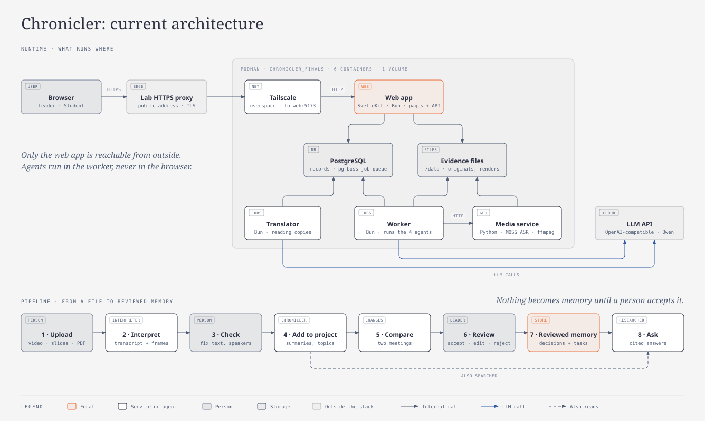

# Chronicler

Chronicler keeps a research team's decisions, the reasons behind them, tasks and open questions traceable across meetings. It reads meeting recordings and documents, lets a person check the result, proposes what changed between two meetings, and answers questions with citations that open the recording at the cited second.

Nothing becomes project memory until a person approves it.



## What you can do

| Step | Where | What happens |
| --- | --- | --- |
| Add a meeting | Project page | Upload a recording, slides, a PDF, an image or a text file. |
| Check the draft | Meeting page | Play the recording beside its transcript, which follows playback. Correct text and speaker names, read the summary, then add the meeting to the project. |
| See what changed | What changed? | Pick an earlier and a later meeting. Chronicler proposes new or changed decisions and tasks, each with the quote behind it. |
| Review | What changed? | Approve, edit and approve, or reject each proposal, with a reason. The original proposal and every review are kept. |
| Read the memory | Memory | Leader view: every meeting, decision and task on one map, with evidence. Student view: the tasks, which can be ticked off. |
| Ask | Ask panel, on every page | Ask in plain words. The answer cites its sources; a citation opens the recording at that second, or the slide or page it came from. |

## Architecture

Six containers run under rootless Podman. Only the web app is reachable from outside; agents run in the worker, never in the browser.

| Service | Runs | Role |
| --- | --- | --- |
| `web` | SvelteKit 3 on Bun | Pages and HTTP API. Runs database migrations on start. |
| `worker` | Bun | Runs the four agents from a PostgreSQL job queue (pg-boss). |
| `translator` | Bun | Makes English and Traditional Chinese reading copies of transcripts. |
| `media` | Python 3.12, FastAPI, GPU | Speech recognition with speaker separation, frame extraction, PPTX and PDF rendering. |
| `database` | PostgreSQL 17 (`pgvector/pgvector:0.8.2-pg17`) | Records, review history and the job queue. |
| evidence volume | `data/` | Original uploads, renders, frames and caches, addressed by content hash. |

The four agents:

| Agent | Trigger | Does | Contract |
| --- | --- | --- | --- |
| Interpreter | An upload | Turns a file into a checkable draft: transcript, slide and page text, frames, coverage warnings. | [docs/agents/interpreter.md](docs/agents/interpreter.md) |
| Chronicler | Add to project | Organises an accepted meeting into summaries, discussion segments and project topics, each tied to exact source text. | [docs/agents/chronicler.md](docs/agents/chronicler.md) |
| Changes | Compare | Compares two accepted meetings and writes pending proposals only. | [reviewed changes](docs/development/reviewed-changes-verification.md) |
| Researcher | A question | Searches approved memory and original evidence with read-only tools and returns a cited answer. | [docs/agents/researcher.md](docs/agents/researcher.md) |

### Data flow

```text
upload ──> Interpreter ──> draft ──> person checks ──> Add to project ──> Chronicler ──> project memory
                                                                                              │
                             reviewed memory <── person approves <── proposals <── Changes <──┘
                                    │
                question ──> Researcher ──> cited answer ──> original recording, slide or page
```

- Original files are never changed. A correction creates a new revision; earlier revisions, summaries and citations are kept.
- A saved answer keeps the memory version it was asked against, so it does not change when the memory later does.
- A task that a meeting reports as finished stays "claimed" until a reviewer verifies it.

## Models and versions

| Purpose | Model | Version | Runs |
| --- | --- | --- | --- |
| Speech recognition and speaker separation | `OpenMOSS-Team/MOSS-Transcribe-Diarize` | revision `704aa4a9c304e8520be88901e0d1960158ef5b15` | Locally on the GPU, in 30-minute windows |
| Reading, organising, comparing, answering | `OPENAI_MODEL`, default `pro6000/qwen38-flash-next` (Qwen, text and images) | Whatever the configured gateway serves | Any OpenAI-compatible Chat Completions endpoint |
| Optional fallback | `OPENAI_FALLBACK_MODEL` | As configured | Used only when the primary gateway fails |
| Chinese script normalisation | OpenCC (`opencc-js` 1.4.2) | 1.4.2 | In the worker |

No embedding model is used. Retrieval combines multilingual keyword search with traversal of the project, topic and segment hierarchy.

## Dependencies

Host: rootless Podman, `podman-compose` 1.5.0 (`uv tool install podman-compose==1.5.0`), and NVIDIA drivers with CDI for the media service. Everything else is installed inside the images from frozen lockfiles (`bun.lock`, `services/media/uv.lock`).

| Part | Main packages |
| --- | --- |
| Web and workers | Bun 1.4.2, SvelteKit 3.0.0, Svelte 5.57.1, Vite 8.3.2, TypeScript 5.9.3, drizzle-orm 0.45.3, postgres 3.4.8, pg-boss 12.36.0, openai 7.27.0, zod 4.3.6, fflate 0.8.2, gsap 3.15.0, phosphor-svelte 3.1.1, Geist (fontsource 5.3.0) |
| Media service | Python 3.12, torch 2.9.0 and torchaudio 2.9.0 (CUDA 12.8 wheels), transformers 5.6.0, moss-transcribe-diarize (pinned commit `61bc29c`), FastAPI 0.135.1, uvicorn 0.41.0, Pillow 12.1.1, python-pptx 1.0.2, FFmpeg |
| Checks | Playwright 1.63.0, svelte-check 4.7.6 |

## Install and run

1. Copy `.env.example` to `.env` and fill in the model gateway address, model name and key.
2. Start the stack and check it:

```sh
./infra/dev.sh up -d --build
./infra/doctor.sh --live
```

3. Open <http://localhost:5173>.

The doctor checks the database schema, the web and media services and the model settings without printing credentials. `--live` makes one small model request.

To rebuild an existing stack, build first and then recreate it:

```sh
./infra/dev.sh build web
./infra/dev.sh down
./infra/dev.sh up -d
```

`down` keeps the database and evidence. Never add `-v`: it deletes them.

A second, separate workspace on another port, with its own database and evidence:

```sh
CHRONICLER_PROJECT=chronicler_trial CHRONICLER_PORT=5174 ./infra/isolated.sh up -d
```

To publish a workspace through an HTTPS reverse proxy, see the [reverse-proxy deployment](docs/deployment/lab-tailnet.md). Backup, restore, cancellation and restart recovery are in [operations](docs/operations.md).

## Environment variables

Set in the private `.env`, which is never committed. `.env.example` lists every supported setting.

| Variable | Required | Meaning |
| --- | --- | --- |
| `OPENAI_BASE_URL`, `OPENAI_MODEL`, `OPENAI_API_KEY` | Yes | The OpenAI-compatible gateway, model name and key used by the agents. |
| `NVIDIA_CDI_DEVICE` | No | GPU for the media service. Default `nvidia.com/gpu=0`; WSL exposes `nvidia.com/gpu=all`. |
| `LLM_MAX_CALLS_PER_OPERATION` | No | Model requests allowed per job. Default 300; 0 disables the limit. |
| `LLM_MAX_INPUT_TOKENS_PER_OPERATION`, `LLM_MAX_OUTPUT_TOKENS_PER_OPERATION` | No | Token ceilings per job. Defaults 2,000,000 and 200,000. |
| `LLM_DAILY_TOKEN_LIMIT` | No | Daily token ceiling. Default 0, which is off. |
| `LLM_INPUT_USD_PER_MILLION`, `LLM_OUTPUT_USD_PER_MILLION` | No | Prices, so the Operations page can show cost. |
| `CHRONICLER_ACCESS_USER`, `CHRONICLER_ACCESS_PASSWORD` | No | Shared sign-in with full access, for separate and hosted workspaces. Leave unset for local use. |
| `CHRONICLER_ACCESS_VIEWER_USER`, `CHRONICLER_ACCESS_VIEWER_PASSWORD` | No | A second sign-in that can look and tick tasks, but not change anything else. |
| `OPENAI_FALLBACK_MODEL`, `OPENAI_FALLBACK_BASE_URL`, `OPENAI_FALLBACK_API_KEY` | No | A second model, used automatically when the primary fails. |
| `OPENAI_FALLBACK_OMIT_TEMPERATURE` | No | Set to 1 for fallback models that reject temperature 0. |
| `LLM_PRIMARY_TIMEOUT_MS`, `LLM_FALLBACK_TIMEOUT_MS`, `LLM_FALLBACK_COOLDOWN_MS` | No | Timeouts, and how long to skip the primary after it fails. |
| `CHRONICLER_PROJECT`, `CHRONICLER_PORT` | For separate workspaces | Workspace name and local port, passed to the `infra/` scripts. |
| `CHRONICLER_ORIGIN` | For hosted workspaces | The exact public HTTPS address. It is compiled into the web image, so set it before building. |

## API

The web app serves a JSON API under `/api`. With a sign-in configured, every endpoint requires it, and the view-only account is refused on anything that changes data, except ticking a task as done.

| Area | Endpoints |
| --- | --- |
| Health | `GET /api/health` |
| Uploads | `/api/upload-sessions`, `/api/uploads`, `/api/uploads/[id]` with `processing`, `captions`, `corrections`, `summary`, `translations`, `export`, `retry`, `cancel` |
| Add to project | `/api/selections`, `/api/pushes`, `/api/pushes/[id]` with `retry`, `cancel` |
| Comparisons and review | `/api/comparisons`, `/api/comparisons/[id]` with `retry`, `cancel`; `/api/change-proposals/[id]/review` |
| Memory | `/api/memory`, `/api/memory/organized`, `/api/memory/organized/search`, `/api/memory/nodes/[id]`, `/api/memory/reports`, `/api/memory/tasks/[id]/done`, `/api/projects/[id]/hidden` |
| Ask | `/api/research`, `/api/research/[id]` |
| Evidence and files | `/api/evidence/[revisionId]/[primitiveId]`, `/api/assets/[id]` |
| Activity | `/api/activity` |

Route handlers are in `apps/web/src/routes/api`. The media service has an internal HTTP API on the container network only (`services/media/app.py`).

## Permissions and data handling

- **Sign-in.** One shared workspace. With no sign-in configured the app is open, which suits a single machine: the web port binds to loopback only. A hosted workspace sets the full-access account and, if wanted, the view-only account. There are no per-person accounts or roles yet.
- **Human approval.** A meeting enters a project only when a person adds it. A proposed change enters memory only when a person approves it. Rejected and unreviewed proposals are never used in answers.
- **Read-only agent.** The Researcher's tools can read approved memory and evidence; they cannot change either.
- **What leaves the machine.** Audio stays local: speech recognition runs on the GPU. Transcript text, slide and page text and selected images are sent to the configured model gateway, and to the fallback provider while it is in use.
- **Usage record.** Each model request is logged with the job, model, timing and token counts, without prompts, images or keys. The Operations page shows the day's usage against the limits.
- **Restored workspaces** start read-only until resumed.

## Known limits

- Speaker names are suggestions until a person confirms them. A speaker is not tracked across 30-minute processing windows, so a long meeting can show the same person under two labels.
- Meeting order is not inferred from filenames or upload dates. When a meeting's date is unknown, a comparison shows a warning.
- A comparison can finish without any valid proposal and report a failure. Retrying is the only remedy for now; the cause has not been investigated.
- No semantic or embedding search. A question phrased very differently from the source may miss it.
- Summaries are written in English. Original text and quotes are kept in their own language.
- PPTX fonts, hidden slides, animations and uncertain OCR are flagged, not reconstructed.
- No next-meeting brief, and no automatic comparison when a meeting is added.
- Automated quality checks use the same model as a judge and are not a substitute for human review.

## Troubleshooting

| Symptom | What to do |
| --- | --- |
| The web container exits right after `up` | The database was not ready in time. Start the web container again (`podman start <name>`). |
| A dependent container fails to be replaced on rebuild | Use the build, `down`, `up -d` sequence above. |
| The media service does not start, or finds no GPU | Run `nvidia-ctk cdi list` and set `NVIDIA_CDI_DEVICE` to a listed device. |
| Forms are refused on a hosted address | The address the browser uses must match `CHRONICLER_ORIGIN` exactly. Set it and rebuild the web image. |
| Model requests fail or time out | Run `./infra/doctor.sh --live`. Check the gateway address, model name and key, or configure the fallback model. |
| A job stops with a limit message | Raise the matching `LLM_MAX_*` value and recreate the workers. |
| A job is stuck after a restart | Workers requeue jobs whose owner disappeared within about 30 seconds. Otherwise use Retry on the item. |
| A transcript keeps arriving after Cancel | A GPU window that had already started is allowed to finish; nothing new is published. |

More in [operations](docs/operations.md).

## Checks

All checks run in Podman, with no JavaScript dependencies on the host:

```sh
./infra/test.sh check
./infra/test.sh unit
./infra/test.sh integration
./infra/test.sh documents
./infra/test.sh media
./infra/test.sh browser
./infra/test.sh build
```

Integration checks create their own disposable database. The document, media and browser checks need a private set of recordings and documents that is not in this repository. See the [testing guide](docs/development/testing.md), the [maintained evaluations](evals/README.md) and the [acceptance history](docs/development/acceptance.md).

## Repository layout

| Path | Contents |
| --- | --- |
| `apps/web` | SvelteKit app, API, agents (`src/lib/server/agents`), workers, database migrations, tests |
| `services/media` | Python media and speech service |
| `infra` | Containerfiles, Compose files, start, check, backup and restore scripts |
| `evals` | Evaluation questions and runners, kept out of release images |
| `docs` | Agent contracts, deployment, operations, verification records |
| `plan.md` | Design and development history |

## Licence and third-party components

This repository does not yet include a licence file. The packages and models listed above are used under their own licences; see each project for its terms.
