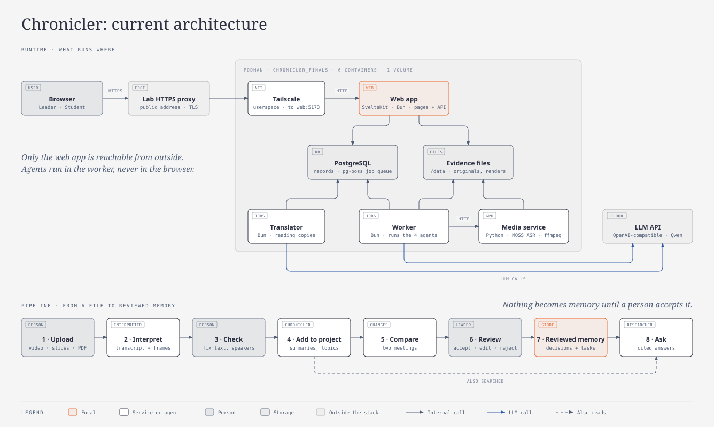

# Chronicler（中文版）

[English version](README.md)

Chronicler 讓研究團隊的決策、決策背後的理由、待辦事項與未解問題，能夠跨會議持續追溯。它讀取會議錄影與文件，讓人員檢查結果，提出兩場會議之間的變更，並以附出處的回答回覆問題；點選出處即可開啟錄影並跳到被引用的那一秒。

未經人員核准的內容，不會成為專案記憶。



## 可以做什麼

| 步驟 | 位置 | 內容 |
| --- | --- | --- |
| 新增會議 | 專案頁面 | 上傳錄影、投影片、PDF、圖片或文字檔。 |
| 檢查草稿 | 會議頁面 | 錄影與逐字稿並排播放，逐字稿會跟隨播放進度。可修正文字與說話者名稱、閱讀摘要，再將會議加入專案。 |
| 查看變更 | What changed? | 選擇一場較早與一場較晚的會議。Chronicler 會提出新增或變更的決策與待辦事項，每一項都附上對應的原話。 |
| 審核 | What changed? | 對每項提案核准、修改後核准或退回，並填寫理由。原始提案與每次審核紀錄都會保留。 |
| 閱讀記憶 | Memory | Leader 檢視：以一張圖呈現所有會議、決策與待辦事項及其證據。Student 檢視：待辦清單，可勾選完成。 |
| 提問 | Ask 面板（每一頁都有） | 以一般語句提問。回答會附上出處；點選出處會開啟錄影並跳到該秒，或開啟對應的投影片或頁面。 |

## 架構

共六個容器，以 rootless Podman 執行。只有 Web 應用程式可從外部連線；Agent 在 worker 中執行，不在瀏覽器中執行。

| 服務 | 執行環境 | 角色 |
| --- | --- | --- |
| `web` | SvelteKit 3（Bun） | 頁面與 HTTP API。啟動時執行資料庫遷移。 |
| `worker` | Bun | 從 PostgreSQL 工作佇列（pg-boss）執行四個 Agent。 |
| `translator` | Bun | 產生逐字稿的英文與繁體中文閱讀版本。 |
| `media` | Python 3.12、FastAPI、GPU | 語音辨識與說話者分離、影格擷取、PPTX 與 PDF 轉圖。 |
| `database` | PostgreSQL 17（`pgvector/pgvector:0.8.2-pg17`） | 資料紀錄、審核歷史與工作佇列。 |
| 證據儲存區 | `data/` | 原始上傳檔、轉圖、影格與快取，以內容雜湊定址。 |

四個 Agent：

| Agent | 觸發時機 | 工作內容 | 規格文件 |
| --- | --- | --- | --- |
| Interpreter | 上傳檔案 | 將檔案轉成可檢查的草稿：逐字稿、投影片與頁面文字、影格、涵蓋範圍警告。 | [docs/agents/interpreter.md](docs/agents/interpreter.md) |
| Chronicler | 加入專案 | 將已接受的會議整理為摘要、討論段落與專案主題，每一項都對應到確切的來源文字。 | [docs/agents/chronicler.md](docs/agents/chronicler.md) |
| Changes | 比較 | 比較兩場已接受的會議，只產生待審核的提案。 | [reviewed changes](docs/development/reviewed-changes-verification.md) |
| Researcher | 提問 | 以唯讀工具搜尋已核准的記憶與原始證據，回傳附出處的回答。 | [docs/agents/researcher.md](docs/agents/researcher.md) |

### 資料流程

```text
上傳 ──> Interpreter ──> 草稿 ──> 人員檢查 ──> 加入專案 ──> Chronicler ──> 專案記憶
專案記憶 ──> Changes ──> 提案 ──> 人員核准 ──> 已審核記憶
提問 ──> Researcher（讀取已審核記憶與原始證據）──> 附出處的回答 ──> 原始錄影、投影片或頁面
```

- 原始檔案不會被更動。每次修正都會產生新的版本；先前的版本、摘要與引用都會保留。
- 已儲存的回答會保留提問當時的記憶版本，因此日後記憶更新時，該回答不會改變。
- 會議中回報為完成的待辦事項，在審核者確認之前，狀態維持為「已聲稱完成」。

## 模型與版本

| 用途 | 模型 | 版本 | 執行位置 |
| --- | --- | --- | --- |
| 語音辨識與說話者分離 | `OpenMOSS-Team/MOSS-Transcribe-Diarize` | revision `704aa4a9c304e8520be88901e0d1960158ef5b15` | 本地 GPU，以 30 分鐘為一個處理區段 |
| 閱讀、整理、比較、回答 | `OPENAI_MODEL`，預設 `pro6000/qwen38-flash-next`（Qwen，文字與影像） | 依所設定的閘道而定 | 任何相容 OpenAI Chat Completions 的端點 |
| 選用的備援模型 | `OPENAI_FALLBACK_MODEL` | 依設定而定 | 僅在主要閘道失敗時使用 |
| 中文字形正規化 | OpenCC（`opencc-js` 1.4.2） | 1.4.2 | 在 worker 中 |

未使用 embedding 模型。檢索結合多語言關鍵字搜尋，以及專案、主題與段落階層的走訪。

## 相依套件

主機需求：rootless Podman、`podman-compose` 1.5.0（`uv tool install podman-compose==1.5.0`），以及供 media 服務使用的 NVIDIA 驅動程式與 CDI。其餘套件皆依鎖定檔（`bun.lock`、`services/media/uv.lock`）安裝於映像檔內。

| 部分 | 主要套件 |
| --- | --- |
| Web 與 worker | Bun 1.4.2、SvelteKit 3.0.0、Svelte 5.57.1、Vite 8.3.2、TypeScript 5.9.3、drizzle-orm 0.45.3、postgres 3.4.8、pg-boss 12.36.0、openai 7.27.0、zod 4.3.6、fflate 0.8.2、gsap 3.15.0、phosphor-svelte 3.1.1、Geist（fontsource 5.3.0） |
| Media 服務 | Python 3.12、torch 2.9.0 與 torchaudio 2.9.0（CUDA 12.8 版本）、transformers 5.6.0、moss-transcribe-diarize（鎖定 commit `61bc29c`）、FastAPI 0.135.1、uvicorn 0.41.0、Pillow 12.1.1、python-pptx 1.0.2、FFmpeg |
| 檢查工具 | Playwright 1.63.0、svelte-check 4.7.6 |

## 安裝與執行

1. 將 `.env.example` 複製為 `.env`，填入模型閘道位址、模型名稱與金鑰。
2. 啟動並檢查：

```sh
./infra/dev.sh up -d --build
./infra/doctor.sh --live
```

3. 開啟 <http://localhost:5173>。

doctor 會檢查資料庫結構、web 與 media 服務以及模型設定，且不會印出任何憑證。`--live` 會送出一次小型的模型請求。

重建既有環境時，請先建置再重新建立：

```sh
./infra/dev.sh build web
./infra/dev.sh down
./infra/dev.sh up -d
```

`down` 會保留資料庫與證據。請勿加上 `-v`，否則會將其刪除。

若要在另一個連接埠啟動第二個獨立工作區（擁有自己的資料庫與證據）：

```sh
CHRONICLER_PROJECT=chronicler_trial CHRONICLER_PORT=5174 ./infra/isolated.sh up -d
```

若要透過 HTTPS 反向代理對外提供工作區，請參閱[反向代理部署](docs/deployment/lab-tailnet.md)。備份、還原、取消與重啟復原請參閱[操作說明](docs/operations.md)。

## 環境變數

設定於私有的 `.env`，該檔案不會提交至版本庫。`.env.example` 列出所有支援的設定。

| 變數 | 是否必要 | 說明 |
| --- | --- | --- |
| `OPENAI_BASE_URL`、`OPENAI_MODEL`、`OPENAI_API_KEY` | 是 | Agent 使用的 OpenAI 相容閘道、模型名稱與金鑰。 |
| `NVIDIA_CDI_DEVICE` | 否 | media 服務使用的 GPU。預設 `nvidia.com/gpu=0`；WSL 為 `nvidia.com/gpu=all`。 |
| `LLM_MAX_CALLS_PER_OPERATION` | 否 | 每項工作允許的模型請求次數。預設 300；0 表示不限制。 |
| `LLM_MAX_INPUT_TOKENS_PER_OPERATION`、`LLM_MAX_OUTPUT_TOKENS_PER_OPERATION` | 否 | 每項工作的 token 上限。預設 2,000,000 與 200,000。 |
| `LLM_DAILY_TOKEN_LIMIT` | 否 | 每日 token 上限。預設 0，即關閉。 |
| `LLM_INPUT_USD_PER_MILLION`、`LLM_OUTPUT_USD_PER_MILLION` | 否 | 單價，讓 Operations 頁面可顯示費用。 |
| `CHRONICLER_ACCESS_USER`、`CHRONICLER_ACCESS_PASSWORD` | 否 | 具完整權限的共用登入帳號，用於獨立或對外的工作區。本機使用時請留空。 |
| `CHRONICLER_ACCESS_VIEWER_USER`、`CHRONICLER_ACCESS_VIEWER_PASSWORD` | 否 | 第二組登入帳號，可瀏覽並勾選待辦事項，但不能變更其他內容。 |
| `OPENAI_FALLBACK_MODEL`、`OPENAI_FALLBACK_BASE_URL`、`OPENAI_FALLBACK_API_KEY` | 否 | 備援模型，主要模型失敗時自動使用。 |
| `OPENAI_FALLBACK_OMIT_TEMPERATURE` | 否 | 備援模型不接受 temperature 0 時設為 1。 |
| `LLM_PRIMARY_TIMEOUT_MS`、`LLM_FALLBACK_TIMEOUT_MS`、`LLM_FALLBACK_COOLDOWN_MS` | 否 | 逾時設定，以及主要模型失敗後暫停使用的時間。 |
| `CHRONICLER_PROJECT`、`CHRONICLER_PORT` | 獨立工作區需要 | 工作區名稱與本機連接埠，傳給 `infra/` 下的腳本。 |
| `CHRONICLER_ORIGIN` | 對外工作區需要 | 確切的公開 HTTPS 位址。此值會編譯進 web 映像檔，請在建置前設定。 |

## API

Web 應用程式於 `/api` 提供 JSON API。設定登入後，所有端點皆須登入；唯讀帳號除了將待辦事項勾選為完成之外，無法執行任何會變更資料的操作。

| 類別 | 端點 |
| --- | --- |
| 健康檢查 | `GET /api/health` |
| 上傳 | `/api/upload-sessions`、`/api/uploads`、`/api/uploads/[id]`，以及其下的 `processing`、`captions`、`corrections`、`summary`、`translations`、`export`、`retry`、`cancel` |
| 加入專案 | `/api/selections`、`/api/pushes`、`/api/pushes/[id]`，以及其下的 `retry`、`cancel` |
| 比較與審核 | `/api/comparisons`、`/api/comparisons/[id]`，以及其下的 `retry`、`cancel`；`/api/change-proposals/[id]/review` |
| 記憶 | `/api/memory`、`/api/memory/organized`、`/api/memory/organized/search`、`/api/memory/nodes/[id]`、`/api/memory/reports`、`/api/memory/tasks/[id]/done`、`/api/projects/[id]/hidden` |
| 提問 | `/api/research`、`/api/research/[id]` |
| 證據與檔案 | `/api/evidence/[revisionId]/[primitiveId]`、`/api/assets/[id]` |
| 活動 | `/api/activity` |

路由處理程式位於 `apps/web/src/routes/api`。media 服務的內部 HTTP API 僅在容器網路內提供（`services/media/app.py`）。

## 權限與資料處理

- **登入。** 單一共用工作區。未設定登入時應用程式為開放狀態，適合單機使用：web 連接埠僅綁定於本機迴路。對外的工作區會設定完整權限帳號，並可視需要設定唯讀帳號。目前尚無個人帳號或角色。
- **人工核准。** 會議只有在人員加入後才會進入專案。提案只有在人員核准後才會進入記憶。被退回與尚未審核的提案不會用於回答。
- **唯讀 Agent。** Researcher 的工具只能讀取已核准的記憶與證據，無法變更兩者。
- **離開本機的資料。** 音訊留在本機：語音辨識於 GPU 上執行。逐字稿文字、投影片與頁面文字，以及選取的影像，會傳送至所設定的模型閘道；使用備援模型期間，也會傳送至備援服務。
- **使用紀錄。** 每次模型請求都會記錄所屬工作、模型、時間與 token 數，不包含提示內容、影像或金鑰。Operations 頁面顯示當日用量與上限。
- **還原的工作區**在恢復運作前為唯讀狀態。

## 已知限制

- 說話者名稱在人員確認前僅為建議。說話者無法跨 30 分鐘處理區段追蹤，因此較長的會議中，同一人可能出現兩個標籤。
- 會議順序不會由檔名或上傳日期推斷。會議日期不明時，比較結果會顯示警告。
- 比較可能在沒有任何有效提案的情況下結束並回報失敗。目前唯一的處理方式是重試；原因尚未調查。
- 沒有語意或 embedding 搜尋。提問用語與來源差異很大時，可能找不到對應內容。
- 摘要以英文撰寫。原始文字與引文保留原本的語言。
- PPTX 的字型、隱藏投影片、動畫與不確定的 OCR 結果僅會標示，不會重建。
- 沒有下次會議的簡報摘要，新增會議時也不會自動進行比較。
- 自動化品質檢查使用同一個模型擔任評審，無法取代人工審查。

## 疑難排解

| 狀況 | 處理方式 |
| --- | --- |
| web 容器在 `up` 之後立即結束 | 資料庫尚未就緒。請再次啟動 web 容器（`podman start <name>`）。 |
| 重建時相依的容器無法被取代 | 請使用上述「建置、`down`、`up -d`」的順序。 |
| media 服務無法啟動或找不到 GPU | 執行 `nvidia-ctk cdi list`，並將 `NVIDIA_CDI_DEVICE` 設為清單中的裝置。 |
| 對外位址上的表單被拒絕 | 瀏覽器使用的位址必須與 `CHRONICLER_ORIGIN` 完全一致。設定後請重建 web 映像檔。 |
| 模型請求失敗或逾時 | 執行 `./infra/doctor.sh --live`。檢查閘道位址、模型名稱與金鑰，或設定備援模型。 |
| 工作因上限訊息而停止 | 調高對應的 `LLM_MAX_*` 值，並重新建立 worker。 |
| 重啟後工作卡住 | worker 約在 30 秒內會將擁有者已消失的工作重新排入佇列。否則請對該項目使用 Retry。 |
| 按下 Cancel 後逐字稿仍持續產生 | 已開始的 GPU 處理區段會執行完畢；不會發布任何新內容。 |

更多說明請參閱[操作說明](docs/operations.md)。

## 檢查

所有檢查皆在 Podman 中執行，主機不需安裝 JavaScript 相依套件：

```sh
./infra/test.sh check
./infra/test.sh unit
./infra/test.sh integration
./infra/test.sh documents
./infra/test.sh media
./infra/test.sh browser
./infra/test.sh build
```

整合檢查會自行建立用完即丟的資料庫。文件、媒體與瀏覽器檢查需要一組未包含在本程式碼庫中的私有錄影與文件。請參閱[測試指南](docs/development/testing.md)、[持續維護的評測](evals/README.md)與[驗收紀錄](docs/development/acceptance.md)。

## 程式碼庫結構

| 路徑 | 內容 |
| --- | --- |
| `apps/web` | SvelteKit 應用程式、API、Agent（`src/lib/server/agents`）、worker、資料庫遷移、測試 |
| `services/media` | Python 媒體與語音服務 |
| `infra` | Containerfile、Compose 檔，以及啟動、檢查、備份與還原腳本 |
| `evals` | 評測題目與執行程式，不包含在發行映像檔中 |
| `docs` | Agent 規格、部署、操作說明、驗證紀錄 |
| `plan.md` | 設計與開發歷程 |

## 授權與第三方元件

本程式碼庫尚未包含授權檔案。上列套件與模型依其各自的授權條款使用；詳細條款請參閱各專案。
