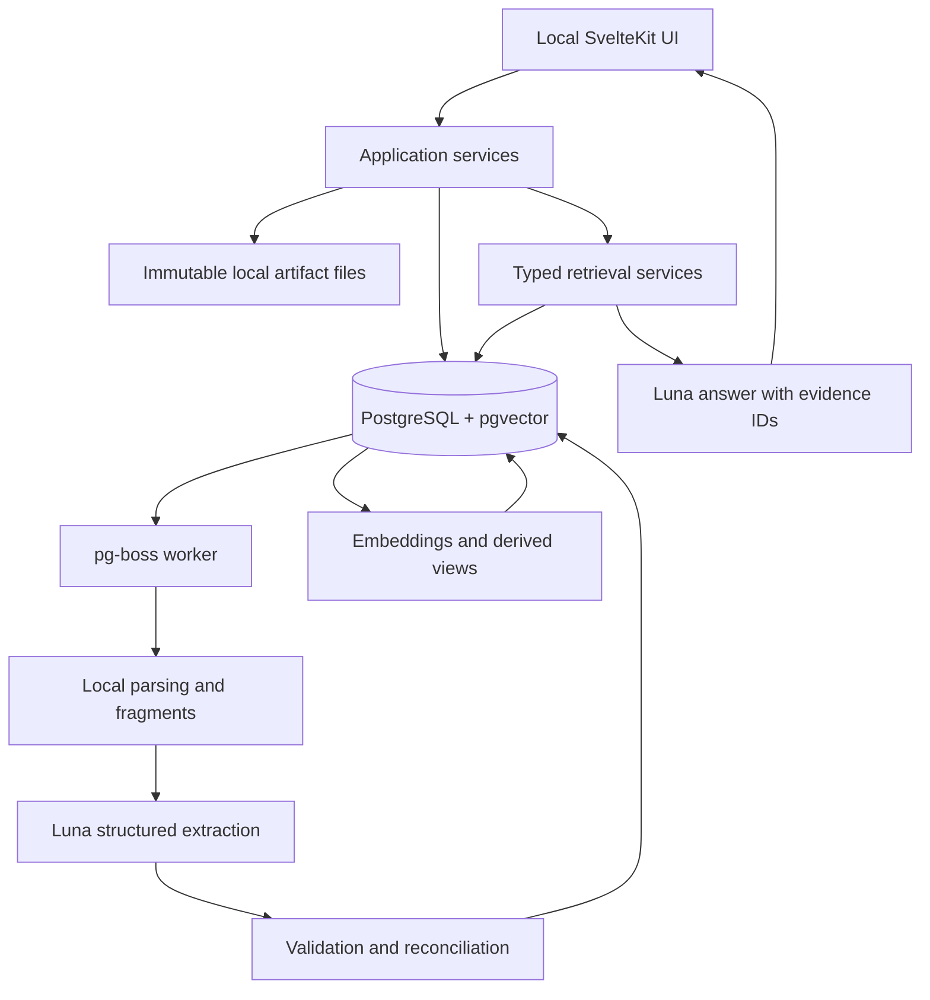

# Archived: original Chronicler MVP implementation plan

Superseded on 2026-09-30 by the root plan and the Interpreter/Chronicler project plans. Preserved for design history; its scope and milestone order are no longer current.

Updated: 2026-09-26. Status: implementation-ready draft; no application code exists yet.

## 1. Outcome and agreed scope

Build a local research knowledge base for one person. Upload meeting transcripts and text-based PDFs, then ask questions about decisions, work, findings, unresolved problems, and changes over time. Every substantive answer should lead back to source evidence.

The defining acceptance test is: **meeting B updates the knowledge established by meeting A, while A's evidence and the history of the change remain available.**

Confirmed with the user:

- Local, single-user application.
- SvelteKit, TypeScript, Drizzle, PostgreSQL, and pgvector.
- Transcripts and text-based PDFs first.
- Hosted OpenAI API processing is acceptable; prefer Luna.
- Preserve conflicting claims, flag uncertainty, and offer optional correction.

Planning assumptions, not user requirements:

- Start evaluation with 6–10 related documents and approximately 40 questions; support a pilot of up to 100 documents / 20,000 fragments before revisiting search infrastructure.
- Transcript formats: UTF-8 TXT/Markdown, SRT, and VTT. PDFs may include slides exported as PDF.
- Languages, actual volume, transcript conventions, spending cap, and deadline remain open. Establish them in M0. Keep Unicode text and aliases intact; add representative language fixtures before claiming language support.
- Dates and project labels can be supplied optionally at upload. Missing information stays unknown; upload time is not silently substituted for meeting time.

### Included

Upload, durable processing status/retry, immutable source files, addressable evidence, structured extraction, conservative entity resolution, versioned knowledge, conflict handling, current/historical retrieval, cited answers, and a small correction interface.

### Deferred

Audio/video transcription, scanned-PDF OCR, chart/formula/table interpretation, native PPTX/DOCX, chat synchronization, code/experiment connectors, multi-user permissions, public hosting, graph databases, autonomous maintenance agents, ontology generation, recommendations, and elaborate dashboards. These should not delay testing persistent knowledge updates.

## 2. Research conclusions and implementation decisions

The sources support useful building blocks; they do not establish that this particular system will work. Corpus-specific evaluation is the acceptance criterion.

| Topic | Finding | Decision for Chronicler |
| --- | --- | --- |
| Structured extraction | Structured Outputs enforce an output shape but can still contain incorrect content. [OpenAI documentation](https://developers.openai.com/api/docs/guides/structured-outputs) | Use typed proposals, then validate schema, evidence spans, references, and temporal rules in application code. A valid JSON object is not a verified research fact. |
| Model | `gpt-6-luna` supports Structured Outputs and function calling. [Model documentation](https://developers.openai.com/api/docs/models/gpt-6-luna) | Default extraction, reconciliation proposals, and answers to Luna through the Responses API. Evaluate it before choosing any alternative; never silently upgrade to a more expensive model. |
| Agent runtime | The Agents SDK runs in the application and supports application-owned tools and state. [SDK documentation](https://developers.openai.com/api/docs/guides/agents/sdk) | Use a deterministic ingestion workflow and, if useful, a bounded query agent. Keep SDK orchestration behind a small adapter so storage and retrieval do not depend on it. |
| Retrieval | pgvector offers exact search and documents combining vectors with PostgreSQL full-text search using rank fusion. Approximate indexes trade recall for speed. [pgvector](https://github.com/pgvector/pgvector) | Start with exact vector search plus lexical and structured retrieval. Add HNSW only if measured latency warrants it, with filtered-recall regression checks. |
| Temporal memory | Graphiti combines entity/relationship extraction, temporal information, and retrieval. [Graphiti overview](https://help.getzep.com/v2/graphiti/getting-started/overview) | Borrow these concepts, but keep our own evidence and history in PostgreSQL. Evaluate adoption only if custom reconciliation proves too expensive to maintain. |
| GraphRAG | The original GraphRAG work targets broad corpus questions using graph communities and summaries. [Research paper](https://arxiv.org/abs/2404.16130) | Defer community detection and hierarchical summaries. Our first benchmark is a small project's evolving decisions and tasks. |
| Database | Drizzle supports vector columns/queries; extensions need explicit installation. PostgreSQL supports timestamp ranges. [Drizzle](https://orm.drizzle.team/docs/extensions), [PostgreSQL ranges](https://www.postgresql.org/docs/current/rangetypes.html) | One database for records, joins, search, and queue infrastructure; SQL migrations explicitly enable required extensions. |
| Background work | pg-boss provides a PostgreSQL-backed Node job queue with retry controls. [Project documentation](https://github.com/timgit/pg-boss) | One separate worker process; no Redis for this MVP. Application writes remain idempotent even when a job retries. |
| PDF evidence | PDF.js exposes page-level text extraction. [PDF.js API](https://mozilla.github.io/pdf.js/api/draft/module-pdfjsLib-PDFPageProxy.html) | Parse locally and preserve page identity. Detect missing/poor text; never report a blank scan as successfully understood. |

### Changes from the master plan

1. Prove reconciliation before polished query UX or snapshots.
2. Keep schemas extensible, but ship a small versioned registry in code instead of a schema designer.
3. Use local disk for original files. Introduce an `ArtifactStore` interface so object storage can be added later.
4. Start with statement arguments in validated JSONB, with a relational entity-reference index, instead of a fully generalized entity–attribute–value system.
5. Add an explicit append-only change ledger. `valid_from`, `valid_to`, and a single creation timestamp alone are insufficient if later corrections overwrite what was previously known.
6. Separate mechanically valid extraction from scientific verification, and source assertions from model inference.

## 3. Architecture



- Run PostgreSQL/pgvector in Docker Compose. Run the Node web server and worker locally from the same repository. Package both for a repeatable local launch in M7.
- SvelteKit uses `adapter-node`. [Deployment documentation](https://svelte.dev/docs/kit/adapter-node)
- Bind the app and any published database port to loopback. No account system for a localhost-only MVP; adding LAN/public access changes that assumption.
- Use Zod for shared application contracts and supported model response schemas.
- Extraction is a sequence of bounded operations, not an autonomous agent loop. The query agent has only read tools, limited turns, and no arbitrary SQL, shell, web browsing, or database writes.
- Use Vitest for domain/integration checks and Playwright for the small set of end-to-end product flows. Database behavior must be tested against real PostgreSQL, not SQLite substitutes.

Suggested layout:

```text
src/routes/                    upload, ask, artifact/evidence views
src/lib/server/db/             Drizzle schema and repositories
src/lib/server/artifacts/      local storage and upload validation
src/lib/server/ingestion/      parsers, fragments, processing stages
src/lib/server/knowledge/      schemas, validation, resolution, history
src/lib/server/retrieval/      lexical/vector/structured/temporal search
src/lib/server/llm/            OpenAI adapter, prompts, usage tracking
src/lib/server/projections/    current state and disposable caches
src/worker/                    queue handlers
evals/                         fixtures, gold labels, evaluation runner
tests/                         unit, PostgreSQL integration, browser tests
drizzle/                       reviewed migrations
data/                          ignored local artifacts and derived parser data
```

## 4. Data model and invariants

### Canonical and operational records

| Record | Minimum purpose and fields |
| --- | --- |
| `artifacts` | UUID, SHA-256, original filename, MIME, byte count, storage key, source kind, source date + date basis, uploaded time. Original bytes immutable. |
| `fragment_sets`, `fragments` | Parser/version identity; artifact ID; stable ordinal; exact extracted text; locator JSON: page, line range, or timestamp range. Reparse creates a new set and preserves cited older fragments. |
| `processing_runs` | Artifact, pipeline/parser/prompt/schema/model versions, stage, attempt, errors, usage, timings, stored proposal output, and publication checkpoint. Operational status may change. |
| `entities`, `entity_aliases` | Stable IDs, type, display name, aliases with provenance and scope. Alias collisions are allowed as unresolved candidates, not forced merges. |
| `activities` | Stable identities for meetings, tasks, and experiments. Changing status, ownership, and outcomes live in versioned statements; do not keep a competing mutable status as canonical truth. |
| `statement_schemas` | Immutable `(name, version)` and JSON schema; seeded from the versioned registry. |
| `statements`, `statement_versions` | Stable identity; immutable content revisions; schema version; arguments JSONB; project/activity references; assertion mode; attribution; reported validity; recorded time; originating run. |
| `statement_entity_refs` | Validated role-to-entity references with foreign keys, written in the same transaction as the version; avoids fragile JSON-only joins. |
| `statement_evidence` | Version-to-fragment links, exact supporting spans and offsets, evidence role, and recorded time. New support is appended. |
| `statement_relations` | Immutable links between exact versions: supports, contradicts, supersedes, answers, motivated_by. Include evidence and provenance for the relationship itself. |
| `knowledge_events` | Append-only acceptance, replacement, retraction, relation activation/revocation, and resolution events; target IDs, effective time if known, recorded time/sequence, reason, source. |

pg-boss owns its queue tables. Embeddings and current-state projections are derived records; their keys include source identity/hash and model or projection version. Project identity can be an entity; an artifact may discuss multiple projects.

### Initial schema registry

Ship `ProjectGoal`, `Decision`, `Commitment`, `Finding`, `Hypothesis`, `ProblemReport`, and `OpenQuestion`. Use `Finding` for simple reported numeric results with metric, value, unit, and conditions; add specialized experimental schemas after the pilot demonstrates a need.

Examples:

- `Decision`: project, choice, optional topic/entity, rationale, effective date.
- `Commitment`: assignee if known, task/activity, deliverable, status, optional due date.
- `Finding`: subject, claim, optional metric/value/unit/conditions, reported verification status.
- `OpenQuestion`: question, project, optional owner; closure requires an explicit answer/resolution.

Every schema defines required roles, allowed entity types, optional fields, and any exclusive state key. Unknown values are explicit nulls or unresolved mentions. Do not let the model create new schemas during ingestion.

### Non-negotiable invariants

1. Canonical statement content and evidence text cannot be silently overwritten. Correcting them appends records.
2. Every accepted extracted assertion has at least one existing, validated evidence span. MVP extraction does not promote unsupported model inferences to canonical assertions.
3. An exact quote proves source presence, not that the quote entails the proposed claim. Semantic correctness is measured separately.
4. Preserve speaker/author attribution when present; document uploader is not automatically the speaker. A research paper's claim is not automatically the lab's belief or decision.
5. Extraction confidence is optional diagnostic metadata, not a calibrated probability or scientific certainty. Only source evidence can establish reported verification.
6. Summaries, chat answers, embeddings, and projections never become evidence automatically.
7. Preserve model proposal outputs and correction events. Rebuilding indexes is deterministic from stored records; re-running an LLM is a new extraction, not a guaranteed identical replay.
8. All publication writes for one artifact revision are atomic. Incomplete stages are not advertised as ready.
9. Retry or re-upload does not duplicate accepted knowledge. Reprocessing with changed prompts creates a new candidate run, then a controlled revision publication.

### Time and statement identity

Maintain two separate questions:

- `effectiveAt`: what period is the question about?
- `knownAt`: what evidence and corrections had the application recorded by then?

Use UTC for instants and preserve source date precision/time zone. Date-only meetings stay date-only where ordering within the day is unknown. Store unknown event time explicitly; do not treat it as evidence valid forever.

Immutable versions contain the validity reported by their source. Later closures, replacements, or corrections are appended to `knowledge_events`, with both effective and recorded time. A projector derives effective intervals; it does not rewrite the original version's `valid_to`.

Historical retrieval first restricts canonical records, evidence links, entity-resolution events, and relation events to `knownAt`, then evaluates accepted changes at `effectiveAt`. Use a monotonic database sequence to resolve recording ties. Only confirmed temporal precedence resolves exclusive state; equally plausible conflicting claims stay disputed. Implement these rules in a pure reducer and test them before adding LLM reconciliation.

Statement identity is not text similarity:

- A status update to the same identified commitment adds a version to that commitment's statement.
- A replacement decision may be a new statement linked by an explicit supersedes relationship.
- Separate experiment conditions or different people's claims remain separate statements.
- Similarity generates candidates; it does not establish duplication, identity, contradiction, or supersession.

Example: meeting A on September 10 says Alice owns task T. Meeting B on September 24 says Bob takes over from September 20. B is uploaded September 26. For September 22, a `knownAt` cutoff before B's ingestion returns Alice; a cutoff after B returns Bob with B's evidence. This is the system's evidence-backed reconstruction, not a claim to know historical truth with certainty.

## 5. Processing and reconciliation

### Upload to published knowledge

1. Validate size and supported format; hash bytes and atomically persist the original file. Initial limits: 25 MiB/file and 200 PDF pages, configurable planning defaults.
2. Deduplicate by content hash. A repeated upload returns the existing artifact; corrected metadata is recorded separately. Reprocessing is an explicit operation.
3. Record the artifact/run and enqueue work transactionally, or use a database outbox if the queue adapter cannot share the transaction. Reconcile orphaned files left by failed database writes.
4. Parse into stable fragments. TXT/Markdown use lines/paragraphs, SRT/VTT retain supplied times, PDFs retain pages and sub-page text offsets. Do not fabricate timestamps or speaker identities.
5. Construct bounded extraction windows over fragments, initially about 2,000–4,000 tokens, with limited neighbor overlap. Window boundaries do not change citation identity. Split oversized fragments with stable offsets; handle cross-boundary references in evaluation.
6. Ask Luna for entity mentions, activities, schema-constrained assertions, quotes/offsets, and possible relationships. Output may be empty, refused, incomplete, or invalid; handle each explicitly.
7. Validate and resolve references. Resolve unique known aliases within context; use candidates for uncertain names. Keep unresolved mention text and candidate IDs without inventing a person.
8. Retrieve potential matches by project, schema, participants, state key, and later semantic similarity. Ask for bounded reconciliation proposals when rules alone cannot decide.
9. Validate proposed changes, serialize publication per workspace for the MVP, and append records/events in a short transaction. Do not hold transactions open while waiting for model responses. Recheck candidates if the workspace revision changed.
10. Build embeddings and views. Track `knowledge_ready` separately from `search_ready`; show indexing failures/retry and never hide an unindexed artifact behind a success label.

Normal stages: `queued → parsing → extracting → reconciling → indexing → ready`. Terminal alternatives include `failed` and `ready_with_warnings`. Optional unresolved conflicts do not block an artifact indefinitely.

### Reconciliation policy

| Situation | Automatic behavior |
| --- | --- |
| Same source span processed again | Idempotent no-op. |
| Equivalent repeated claim | Reuse identity only when attribution, scope, conditions, and time agree; append new evidence. |
| Clear explicit replacement | Record replacement and effective time; preserve the previous assertion and evidence. |
| Different values under different experimental conditions | Keep both; no automatic contradiction. |
| Incompatible assertions without explicit resolution | Keep both and mark a possible conflict. Do not choose a winner by ingestion order or confidence score. |
| Ambiguous entity or missing date | Keep the unresolved mention/date and avoid a destructive merge or temporal replacement. |
| Older document uploaded late | Re-evaluate affected history using source time and explicit relations. It must not displace newer evidence just because it arrived last. |
| User correction | Save a user-authored correction note and resolution event. Retain the original source/model proposal and allow a later compensating correction. |

Corrections cover bad entity links, incorrectly extracted statements, and mistaken conflict/supersession links. Avoid irreversible entity merges in the MVP; use reversible resolution mappings. Historical queries must honor when a mapping was known.

## 6. Retrieval and answer contract

Start with typed services callable from tests and the UI before exposing them as agent tools:

```text
searchEvidence(query, project?, effectiveAt?, knownAt?, limit)
getEntityContext(entityId, effectiveAt?, knownAt?)
getProjectState(projectId, effectiveAt?, knownAt?)
getChanges(projectId, from, to, timeAxis, knownAt?)
getStatementHistory(statementId, knownAt?)
getEvidence(fragmentIds, knownAt?)
```

Use separate retrieval paths for:

- Structured questions: assignments, decisions, open questions, and project goals. Query the canonical model/current projection.
- Similarity questions: combine lexical search and vector search over fragments and statement text. Merge with reciprocal rank fusion, then deduplicate evidence.
- Change questions: query the change ledger and explicitly distinguish effective-time changes from newly recorded information.
- Rationale questions: traverse only a bounded number of accepted relationships, initially at most two hops, with evidence for each claimed causal link.

Initial tuning values: retrieve 20 candidates per semantic/lexical channel, combine, and supply at most 12 evidence fragments within a token budget. These are benchmark parameters, not correctness guarantees. Structured enumeration must paginate or disclose truncation instead of silently returning only a semantic top-k sample.

Default to `text-embedding-3-small`, storing model and dimension with the index; choose and pin dimensions during M1. Luna is the generation model, not the embedding model. [Embedding model documentation](https://developers.openai.com/api/docs/models/text-embedding-3-small)

All retrieval paths apply project and recorded-time constraints before evidence is given to the model. Historical queries must bypass present-day-only snapshots and avoid future evidence through relation traversal. Undated evidence may be shown as undated context but must not establish a dated change.

If the corpus contains Chinese or other text requiring segmentation, benchmark lexical retrieval on it explicitly; do not assume an English full-text configuration provides sufficient recall. Preserve original-language evidence and use exact alias matching plus semantic retrieval while selecting a suitable tokenizer. PostgreSQL parsing is configurable. [Parser documentation](https://www.postgresql.org/docs/18/textsearch-parsers.html)

The answer contract contains answer blocks, citations by known evidence ID, uncertainty/conflict notices, and the interpreted time scope. Application code resolves IDs into links and rejects nonexistent citations. Verify citation existence mechanically; evaluate whether citations actually support claims with human-reviewed labels.

Show disagreements and unanswered questions explicitly. Do not invent missing rationale. Label answer-time inference and cite its premises; never write the inference back as a canonical fact. If evidence is insufficient, say so. Chat history may clarify the question, but is not a source of research facts.

## 7. Testable milestones

Each milestone ends with a repeatable demo and saved verification results. The commands below are proposed implementation contracts, not commands that already exist. Deterministic tests use stored model proposals; paid live-model evaluation is separate and opt-in.

### M0 — Fixtures and acceptance contract

**Deliver:** 6–10 representative artifacts, gold labels, approximately 40 questions, temporal examples, and a one-page evaluation rubric. Begin with synthetic fixtures while representative documents are selected. Reserve at least two documents / ten questions as a holdout; do not tune prompts against them.

**Test:** `pnpm eval:validate-fixtures` checks that every expected assertion/question cites existing source spans, time cutoffs, and the state before/after relevant meetings. Manually review the expected interpretation once.

**Pass:** at least one fixture each for explicit replacement, task reassignment, resolved question, ambiguous conflict, similar names, missing date, out-of-order upload, unrelated PDF, and unsupported scan. Cover all seven question types in the master plan. Languages/metadata conventions are recorded. No model quality claim is made from synthetic fixtures alone.

### M1 — Local foundation and history semantics

**Depends on:** M0.

**Deliver:** SvelteKit shell, PostgreSQL/pgvector Compose service, migrations, schema registry, application contracts, the history reducer, worker skeleton, local storage interface, and `.env.example`.

**Test:** `pnpm test:milestone -- M1` runs migrations on an empty database, FK/uniqueness constraints, version/event replay, and current-versus-historical queries with hand-authored records. `pnpm llm:smoke` separately verifies Luna structured output and embedding access using synthetic text.

**Pass:** database restart preserves records; invalid references fail; previous canonical versions remain unchanged; the September reassignment example returns the two correct answers. Configured model access failure gives an actionable error with no silent model substitution.

### M2 — Upload and citable fragments

**Depends on:** M1.

**Deliver:** upload UI/API, hash deduplication, durable queue, TXT/Markdown/SRT/VTT/PDF parsing, stable fragment sets, source viewer, progress/error display, and retry.

**Test:** `pnpm test:milestone -- M2` uploads fixture files, checks original hashes and locators, repeats an upload, interrupts/restarts parsing, and exercises empty, malformed, oversized, and scanned files.

**Pass:** every accepted fragment opens at the correct source page/line/time; retries produce one published fragment set; reparse preserves older cited fragments; unsupported/low-text pages are reported. Partial PDF coverage is visible, not silently treated as complete ingestion.

### M3 — Evidence-backed structured extraction

**Depends on:** M2.

**Deliver:** Luna proposal adapter, versioned prompts, seven initial schemas, quote validation, conservative entity resolution, attribution, and atomic publication of accepted assertions. Add a basic inspection view to diagnose extraction quality.

**Test:** `pnpm test:milestone -- M3` covers invalid IDs, missing roles, fabricated spans, refusals, incomplete outputs, ambiguous aliases, and cross-window duplicates. `pnpm eval:extract` measures live extraction on the development fixtures.

**Pass:** 100% of published assertions have valid evidence references; deterministic failures cannot corrupt canonical records; development precision is at least 90% and recall at least 80% on adjudicated target assertions. All required decisions and commitments in the small critical fixture set are recovered. Record per-document metrics, not only an aggregate score.

### M4 — Knowledge changes across meetings

**Depends on:** M3. This is the first proof that the product's central idea works.

**Deliver:** candidate reconciliation, explicit replacement rules, conflict relations, append-only resolution events, current-state projection, historical retrieval, and a minimal correction action. Use structured candidate lookup first; embeddings can improve candidates in M5.

**Test:** `pnpm test:milestone -- M4` ingests A then B and B then A; replays stored proposals; injects duplicate jobs; applies and compensates a user correction; rebuilds projections. `pnpm eval:reconcile` checks Luna proposals on labeled pairs.

**Pass:** every critical temporal fixture passes: current state changes correctly, old evidence survives, late uploads do not overwrite newer state, ambiguous conflicts remain visible, and different experiment conditions remain distinct. Both upload orders produce equivalent final effective history where evidence establishes ordering; recorded-time history correctly differs. Rebuild reproduces the same canonical-derived state without any LLM calls.

### M5 — Retrieval and cited answers

**Depends on:** M4.

**Deliver:** embeddings, lexical/structured/temporal search, bounded relationship traversal, optional bounded Agents SDK query adapter, citation contract, and source-linked answers. Retain fragment-only RAG as an evaluation baseline.

**Test:** `pnpm test:milestone -- M5` checks filters, pagination, time cutoffs, citation IDs, token/tool limits, and insufficient-evidence behavior. `pnpm eval:qa` runs the question suite and compares the structured approach with the same model using fragment-only retrieval.

**Pass:** development evidence recall@10 at least 90% on labeled evidence units; at least 85% fully correct answers under the rubric; 100% valid citation IDs; at least 95% of factual claims supported by cited evidence. All critical state/history questions pass. Include absent-answer questions and ensure no later evidence leaks into historical answers. Report cost/latency alongside quality.

### M6 — Complete local workflow

**Depends on:** M5.

**Deliver:** usable upload/status/ask screen, evidence drawer, clear source dates, conflict notices, optional correction controls, and simple project selection when needed. Project state is queried on demand; persistent narrative snapshots remain optional.

**Test:** `pnpm test:e2e` uses mocked model responses with the real application/database to upload A, ask, upload B, ask what changed, open evidence, inspect a conflict, correct it, and inspect history. Run one manual live-model walkthrough separately.

**Pass:** the entire flow works without SQL or developer tooling; refreshing/restarting does not lose processing state; every citation opens the intended source; corrections remain auditable. Failed extraction or indexing has an understandable recovery action.

### M7 — Pilot, recovery, and release gate

**Depends on:** M6.

**Deliver:** documented local start/stop/configuration, pinned dependencies/container versions, backup/restore/export, usage reporting, budget controls, and a holdout evaluation report.

**Test:** `pnpm verify:mvp` aggregates deterministic checks; `pnpm eval:holdout` runs the frozen holdout; manually restore a backup into a fresh database/storage directory. Interrupt the worker before publication and after publication but before queue acknowledgment; simulate rate limits and API downtime.

**Pass:** no duplicate published facts or lost committed records in recovery tests; restored state and citation targets match; all critical history/conflict tests pass; holdout meets the extraction/answer targets above with counts reported. If it fails, fix the relevant earlier milestone and disclose any holdout reuse. On a documented pilot machine/corpus, proposed targets are search p95 below 1 second and complete answer p95 below 20 seconds, measured over at least 30 representative queries. Treat these as targets pending measurement, not guarantees.

## 8. Evaluation rules and the core scenario

Separate four failure classes: parsing/extraction, reconciliation, retrieval, and answer generation. A good answer on one run does not compensate for corrupted history.

- Precision/recall: compare schema, entities, attribution, conditions, and meaning against gold assertions; do not require exact generated wording.
- Answer correctness: fully correct requires the right state/time, relevant attribution/conditions, no unsupported extra claims, and disclosure of material conflicts.
- Evidence recall: count expected source spans found, not merely any page from the correct document.
- Citation support: manually review whether each factual answer claim is entailed by its evidence. An LLM judge can assist but cannot be the sole release authority.
- Repeat live evaluation three times with the same versioned configuration and report variability. Deterministic integration checks remain free of API calls.
- Report numerators/denominators and category breakdowns. Small pilot percentages are diagnostic, not evidence of broad scientific reliability.

Minimum demonstration:

| Input or action | Expected persisted/retrieved result |
| --- | --- |
| Meeting A: team chooses resizing; Alice will test augmentation; cause of regression unresolved | Decision, open commitment, hypothesis/open question, and evidence. |
| Meeting B: resizing disabled after a reported test; Alice's task completed; Bob owns follow-up | Explicit replacement/rationale, completed commitment, new assignment; A remains available. |
| Meeting C: one researcher questions B's result without a team reversal | Both claims preserved; conflict visible; no invented decision reversal. |
| Ask why resizing was dropped | Cited decision plus reported test/rationale; acknowledge any material later dispute. |
| Ask what Alice was working on before B | Earlier assignment with A's evidence. |
| Upload A again, then upload an older transcript | No duplicate facts; current state does not revert merely because of upload order. |
| Ask a question absent from all sources | Explicit insufficient-evidence answer. |
| Delete/rebuild derived indexes and projections in a test database | Same knowledge state and resolvable evidence, with no LLM re-extraction. |

## 9. Reliability, data handling, and cost

- Store API credentials only on the server. Sanitize file paths, escape rendered text, retain upload limits, and treat source instructions as untrusted content. Include a fixture that tries to redirect the extractor/query agent; it must not gain tools or write privileges.
- Use bounded retries with backoff for transient failures. Persist stage checkpoints and outputs so a crash does not repeat every paid call. Unique keys and transactional publication handle repeated delivery.
- Local files and PostgreSQL backups together are required for recovery. Include schemas, fragments, model proposals, and corrections. Indexes can be rebuilt. Do not equate raw-file-only backup with a recoverable knowledge base.
- Log IDs, timing, usage, and errors by default rather than full research content. Keep any diagnostic traces local or explicitly configured.
- Use `store: false` for compatible Responses requests to avoid unnecessary response-state storage. This is not a promise of zero provider retention; API data controls have separate retention rules. [OpenAI data controls](https://developers.openai.com/api/docs/guides/your-data)
- Track extraction, reconciliation, embedding, and answering usage separately. Cache by content/model/prompt/schema version. Default to two model requests in flight and a bounded query loop; tune after measuring.
- Proposed initial guardrail: a configurable USD 5/day application budget and a per-artifact token ceiling. This is a planning default, not the user's agreed spending cap. Reserve estimated maximum request cost before dispatch and stop new work when the cap is reached; report that this is an application control, not a provider billing guarantee.
- At research time, Luna's standard short-context rates are USD 0.10/M input tokens and USD 0.50/M output tokens. An illustrative uncached workload of 1M input + 0.2M output tokens costs USD 0.20 for those generation tokens. This excludes embeddings, retries, cache writes, and other applicable charges; use actual usage and current rates during implementation. [Luna pricing](https://developers.openai.com/api/docs/models/gpt-6-luna)

## 10. Execution order and remaining decisions

Build in order: **M0 → M1 → M2 → M3 → M4 → M5 → M6 → M7**. Revisit the extraction/reconciliation design if M4 fails; adding a better chat interface will not resolve incorrect persisted knowledge.

The smallest useful technical checkpoint is M4 with an inspection screen. The user-facing MVP is complete only after M7. Do not mark milestones done just because their code exists; attach their test/demo evidence.

Before M0 closes, record:

1. Actual pilot artifacts, languages, date/speaker conventions, and expected corpus growth.
2. Desired deadline and spending cap. No delivery date has been promised.
3. Which forms of user correction are needed most often during the pilot.
4. Confirmed Luna API access and chosen embedding dimensions during the M1 smoke test.

Progress:

- [ ] M0: acceptance corpus and rubric
- [ ] M1: local foundation and temporal contract
- [ ] M2: upload and citable fragments
- [ ] M3: evidence-backed extraction
- [ ] M4: reconciliation and history
- [ ] M5: retrieval and answers
- [ ] M6: complete local UI workflow
- [ ] M7: pilot evaluation and recoverable release
