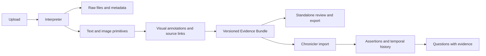

# Archived: Interpreter + Chronicler — monorepo plan

Superseded on 2026-10-04 by the SvelteKit-centered application and worker design in the root plan. The separate-app architecture below is retained only as design history.

Updated: 2026-09-30. Status: revised architecture and testable milestones; application code is not implemented.

## 1. Two projects, one evidence contract

| Project | Responsibility | Output |
| --- | --- | --- |
| **Interpreter** | Convert source material into addressable text and image primitives, preserve metadata and source structure, and add explicitly labeled visual context. | Versioned **Evidence Bundles**, an independent review UI, and exports. |
| **Chronicler** | Extract research assertions, resolve entities, reconcile changes, maintain history, and answer questions. | Persistent research knowledge with citations to source evidence. |

Interpreter answers “What is present in this source, and where?” Chronicler answers “What did the researchers claim, decide, do, or change, and what supports that interpretation?”

Research decisions, commitments, hypotheses, and current project state belong to Chronicler. Interpreter may suggest document type, language, title, or topic labels, but preserves their origin and uncertainty.

- [Interpreter implementation plan](projects/interpreter/plan.md)
- [Chronicler implementation plan](projects/chronicler/plan.md)
- [Original plan, archived](../2026-09-26-plan.md)

## 2. Confirmed scope and environment

- Both projects run on this machine, for one user. No remote GPU service is needed in the initial design.
- SvelteKit, TypeScript, Drizzle, PostgreSQL/pgvector remain the application stack; Interpreter adds an isolated Python media/model runtime.
- Existing permission to use OpenAI APIs, with Luna preferred, remains. Local application deployment does not imply local VLM processing. MOSS transcription and media processing run locally; an all-local VLM can later replace the hosted adapter.
- Interpreter must work independently with upload/review/export.
- **First useful release: meeting video → diarized transcript → linked visual context and referenced frames.**
- PDF, PPTX, standalone images, and text use additional adapters under the same contract.
- Chronicler preserves conflicting claims and allows optional correction.

Observed on this machine on 2026-09-30: Ubuntu 26.04.1, two NVIDIA RTX PRO 6000 Blackwell Max-Q Workstation Edition GPUs, each reporting 97,887 MiB total VRAM, and approximately 181 GiB RAM. FFmpeg, ffprobe, Python, Node, and uv are available on PATH; pnpm and Docker were not found on PATH. This is an inventory, not a successful model/runtime compatibility test. Start MOSS on one GPU with concurrency one and measure before scaling.

Corpus languages, recording lengths, pilot files, disk budget, API spending cap, and deadline remain open. Do not infer meeting languages from the host environment.

This replaces the previous transcript/PDF-first release order. Public hosting, multiple users, synchronization connectors, graph databases, recommendations, and autonomous maintenance remain deferred.

## 3. Monorepo and runtime organization

```text
projects/
  interpreter/
    plan.md
    web/                  SvelteKit upload, viewer, review, export
    server/               TypeScript services, jobs, VLM adapter
    media/                isolated Python ASR/media adapters
    migrations/           interpreter schema only
    tests/
  chronicler/
    plan.md
    web/                  SvelteKit knowledge/chat/evidence UI
    server/               import, knowledge, reconciliation, retrieval
    migrations/           chronicler schema only
    tests/
packages/
  evidence-contract/      JSON Schema, generated TS/Python types, fixtures
infra/                    local startup and optional Compose configuration
evals/                    separate Interpreter and Chronicler gold datasets
data/                     ignored raw files, derivatives, bundles, caches
```

Use a pnpm workspace for TypeScript and pinned Python dependencies for Interpreter. FFmpeg and document-rendering tools belong to Interpreter. Avoid putting GPU libraries in the web server process.

One PostgreSQL instance is sufficient, using separate `interpreter` and `chronicler` schemas, migrations, and database roles. Each project owns its writes. The import contract must also work with separate databases; no cross-schema ORM dependency or foreign key is required.

The Node worker owns pg-boss jobs and invokes a narrow local Python job interface. Python does not manipulate queue internals. Prefer a warm local model process once measured. Choose native PostgreSQL or install a container runtime during foundation work; do not assume Docker is already installed.



Two projects do not require a distributed services platform. Local processes/files are sufficient. Bind UIs and published database ports to loopback. Share a UI component package only when actual repeated needs appear.

## 4. Evidence Bundle v1

A bundle is a durable source representation: a manifest plus content-addressed assets. Markdown is generated for reading, not the machine source of truth.

| Element | Required meaning |
| --- | --- |
| Identity | Contract version, bundle ID/revision, submission ID, raw hash, run ID. |
| Source | Filename/MIME/hash, uploader, upload time, optional event/source time with precision and basis, raw-source availability. |
| Primitives | IDs stable within an immutable revision; `text` or `image`; role; content/asset reference; source locator; derivation method. |
| Structure | Reading/time order, parent groups, page/slide relationships, transcript-to-frame links, figure/caption associations. |
| Metadata | Value plus origin: user-supplied, file-embedded, parser-observed, or model-inferred; preserve conflicting candidates. |
| Lineage | Parent asset/primitive IDs, extractor/model/prompt/config versions, transforms, hashes, creation time. |
| Coverage | Processed ranges/pages, visually inspected times/regions, omissions/errors, modality completeness, and budget stops. |
| Exports | Deterministic Markdown/VTT/JSON renderings and a manifest of included files. |

Text roles include source text, ASR transcript, OCR, speaker notes, and generated visual annotation. Image roles include original image, page/slide render, extracted figure, frame, and crop. Hierarchy, relationships, and optional table/layout structures surround these two payload primitives; do not flatten away useful structure.

Locators are typed: text spans, media time in integer milliseconds relative to a declared source timeline, one-based page/slide numbers, and bounding boxes with explicit units/origin/parent dimensions. Record actual decoded frame time separately from requested time.

ASR/OCR is a fallible source representation. A visual caption is a further interpretation. Chronicler must distinguish them and be able to load the underlying image when a claim depends on it.

### Publication and consumption

1. Write immutable assets and a candidate manifest; validate references/hashes, then atomically publish the revision.
2. Start with explicit export/import. Later add local API polling for published revisions; no broker is needed.
3. Chronicler validates the bundle, records an import receipt keyed by ID/revision, and stores its own manifest and required evidence assets. It does not read Interpreter's private database tables.
4. Repeated delivery is a no-op. New revisions can trigger knowledge corrections without changing evidence already cited by older versions.
5. Full portable export includes the raw source and required derivatives. Compact export may omit raw media but must declare the omission and preserve all included links. Do not call an export self-contained if it depends on a local path or running service.

Provider-specific image serialization and context limits belong to adapters. “Any VLM” means an open interchange format, not identical compatibility or capability across models.

## 5. Testable milestone map

Proposed commands in these documents are implementation contracts, not commands that already exist.

| Milestone | Checkpoint |
| --- | --- |
| S0 | Evidence contract, fixtures, and hardware/runtime feasibility. |
| I1 | Interpreter standalone shell, raw ingestion, metadata, text bundles/export. |
| I2 | Local MOSS produces a timestamped, speaker-labeled transcript. |
| I3 | Contact-sheet inspection and visual enrichment produce linked frame assets. |
| I4 | Standalone video release: review, correction, export, restart, restore. |
| I5 | PDF/PPTX/image adapters with page/slide/region provenance. |
| C1 | Chronicler imports bundles idempotently and resolves evidence independently. |
| C2 | Research assertion extraction with evidence/quality gates. |
| C3 | Reconciliation and historical queries pass meeting A/B/C tests. |
| C4 | Retrieval and answers use text/images with citations. |
| C5 | Combined workflow passes holdout evaluation and recovery checks. |

Build **S0 → I1 → I2 → I3 → I4** for the first useful product. C1–C3 can use frozen bundles after S0; they do not need every document adapter. Complete I5 and C4–C5 for the full requested multimodal MVP. This is a dependency map, not a requirement to use parallel agents.

### S0 — Contract and feasibility

**Deliver:** JSON Schema with TS/Python types; example bundles; a representative video with labeled transcript excerpts/visual references; measured model/resource limits; documented supported formats.

**Test:** `pnpm test:contract` validates the same fixtures in both runtimes and rejects bad references/hashes. Run a local MOSS smoke test, then a representative-duration test; record GPU/runtime versions, peak VRAM, latency, and completeness.

**Pass:** both projects agree on time units, roles, coordinates, IDs, revisions, and coverage. Hardware capability is measured rather than inferred from VRAM. If a recording cannot be processed, choose an explicit duration limit or tested chunking policy before claiming support.

## 6. Shared invariants

- Original files, published primitive sets, and accepted knowledge versions are immutable; corrections append revisions/events.
- Deduplicate bytes separately from submission context. Same bytes can have different uploader/metadata histories.
- A frame, its OCR, and its caption share lineage; they are not independent confirmations.
- Diarization IDs are local to a recording/run, not global person IDs.
- Source time, upload time, extraction time, import time, and effective knowledge time remain distinct.
- Partial processing stays visible. Sampled frames do not establish exhaustive video coverage.
- Interpreter improves the source representation; Chronicler decides how that affects accepted knowledge.
- Backup both projects' records plus manifests/raw files/derivatives/corrections. Rebuilding caches differs from rerunning a model.

Evaluate Interpreter source fidelity separately from Chronicler knowledge accuracy. Include an end-to-end case where a frame contains information absent from speech. No delivery date or unmeasured performance guarantee is set.
