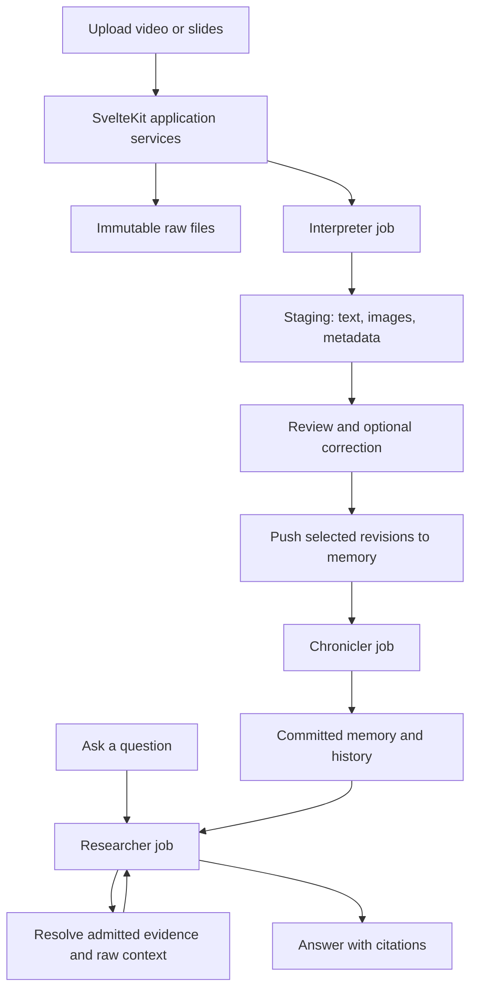

# Chronicler — SvelteKit application and agent workers

Updated: 2026-10-06. Status: M0 and M1 accepted; M2 video staging is functionally accepted on all three supplied real Mandarin meetings. M3 document staging and revision selection are functionally accepted on eight supplied documents (255 page/slide renders). The generated-media pilot was retired by the user; human transcription and speaker-accuracy review remain pending. See [acceptance evidence](docs/development/acceptance.md).

## 1. Product and architecture

One local SvelteKit application owns the UI, API, Drizzle schema/migrations, database services, file storage, and job lifecycle. Interpreter, Chronicler, and Researcher are agent/workflow modules executed by workers using those application services.

| Component | Trigger | Responsibility | Result |
| --- | --- | --- | --- |
| SvelteKit app | User actions | Upload, staging review, push, memory views, questions, evidence viewer, progress/errors | One coherent product and source of application state |
| Interpreter | Upload or explicit reprocessing | Convert raw media/documents into text/image primitives with metadata and provenance | A reviewable staging revision |
| Chronicler | User selects staged revisions and clicks **Push to memory** | Extract research assertions, resolve entities, reconcile changes, publish accepted knowledge | A committed memory revision |
| Researcher | User asks a question | Query committed memory, follow evidence to sources, reason and cite | An evidence-backed answer |

Raw files → Interpreter → staging → user push → Chronicler → memory is the ingestion lifecycle. Questions → Researcher → memory and its source evidence → answers is the query lifecycle.

The agent proposes interpretations or uses narrow tools. Application code validates references, enforces lifecycle transitions, and performs database writes. No model receives arbitrary SQL or unrestricted filesystem access.

Detailed module plans:

- [Interpreter](docs/agents/interpreter.md)
- [Chronicler](docs/agents/chronicler.md)
- [Researcher](docs/agents/researcher.md)

## 2. Agreed scope and prior decisions

- Run on this machine for one user. One UI and one Drizzle-owned application schema replace the previous two-app design.
- SvelteKit, TypeScript, PostgreSQL/pgvector, Drizzle; Bun is the primary JavaScript runtime/package manager/script runner, with a durable PostgreSQL-backed job queue and isolated Python media runtime.
- Podman contains development and production execution: web, worker, database, and media services. Commit regularly once implementation starts. Finish with cleanup of temporary milestone traces/tests while retaining lasting regression coverage.
- Video, PPTX, PDFs, images, and text are input adapters. Prove video staging first; the complete requested workflow also includes PPTX and the remaining adapters.
- Local MOSS transcription; use the configured OpenAI-compatible gateway and `pro6000/qwen38-flash-next` as the core model for development testing. Read `OPENAI_API_KEY`, `OPENAI_MODEL`, and `OPENAI_BASE_URL` from private server environment configuration. Model adapters remain configurable; this preference supersedes Luna as the development default.
- Staging supports inspection and optional correction/export without requiring memory ingestion.
- Agent planning, questions, tool-search reasons, annotations, and explanations use English. Chinese source quotations and names retain Chinese script. Transcribed Chinese is normalized to OpenCC standard Traditional Chinese (`s2t`) before review/export and after speech corrections; preserve raw ASR output and earlier revisions.
- Explicit push is required before staged evidence affects memory. Researcher uses committed memory and evidence admitted by completed pushes.
- Preserve unresolved conflicts and history; offer optional correction.

Observed on 2026-09-30: Ubuntu 26.04.1, two RTX PRO 6000 Blackwell Max-Q GPUs reporting about 96 GiB VRAM each, and about 181 GiB RAM. Bun 1.4.2 and Podman 5.7.0 were verified on 2026-10-05. Git is initialized and implementation changes are committed locally. MOSS CUDA inference and NVIDIA CDI access passed inside rootless Podman on GPU 0, with concurrency one. Initial accepted transcripts of the 65–157-minute meetings used three-minute sections. New processing uses 30-minute windows directly, avoiding repeated long-pass early stops; speaker IDs are scoped to the successful input windows. Qwen reads the complete transcript before targeted frame research, and stores tentative, evidence-backed names separately from anonymous codes. The operational duration ceiling is four hours, with one GPU inference at a time. Cross-section speaker matching and reference-based accuracy remain open.

The configured gateway passed live, synthetic-data checks on 2026-10-05 from Bun under Podman: requested model discovery, text chat, JSON Schema output, function-call/result round trip, image input, streaming, and Responses API. The supplied root base URL works for both chat and Responses routes. See the [API verification record](docs/development/llm-api-check.md). These checks establish basic request compatibility; full SDK integration, research-quality evaluation, embedding access, and sustained-load behavior remain milestone work.

The user supplied mostly Mandarin recordings, approximately 65, 109, and 157 minutes, with perhaps ten participants and mostly nonoverlapping speech. Participant count is uncertain and is not a required model output. Human quality annotations, API/disk budgets, and deadline remain open. Multi-user/public hosting, connectors, graph databases, recommendations, and autonomous memory upkeep remain deferred.

## 3. Repository structure and runtime

```text
apps/
  web/
    src/routes/                      upload, staging, memory, ask, evidence
    src/lib/server/
      db/                            Drizzle schema, client, repositories
      services/                      lifecycle rules and transactions
      agents/
        interpreter/                 source extraction/enrichment workflow
        chronicler/                  memory extraction/reconciliation workflow
        researcher/                  read-only query workflow
      jobs/                          queue dispatch, handlers, checkpoints
      contracts/                     staging, memory, tool/response schemas
      storage/                       raw/derived assets and source resolution
      llm/                           model adapters, prompts, usage budgets
      retrieval/                     structured, lexical, vector, temporal
    workers/run.ts                   separate Bun worker entrypoint
    drizzle/                         single migration history
    tests/                           unit, PostgreSQL, browser tests
services/
  media/                             Python MOSS/document/media runtime
docs/agents/                         detailed worker plans
evals/                               maintained quality evaluation fixtures
infra/                               Containerfiles and Podman orchestration
data/                                ignored originals, derivatives, caches
```

Use Bun workspaces and a committed `bun.lock`; use `bun install --frozen-lockfile` in container builds. Run JavaScript/TypeScript scripts with Bun and prefer `bun test` for suitable domain tests. Browser/component tooling can have its own runner invoked through Bun. Keep the Python media dependencies separately pinned inside their container. Keep domain/server modules runtime-neutral: workers import them through relative/package imports and receive validated config, rather than relying on SvelteKit request state, `$app` modules, or route handlers. Drizzle and migrations stay in the SvelteKit project; a worker is another entrypoint into the same server code.

Run one Bun web container, initially one Bun worker container with separate job handlers/concurrency limits, one Python media container as needed, and one PostgreSQL/pgvector container. Reserve execution capacity for Researcher so long ingestion jobs do not delay questions. Additional worker containers can consume the same queues later.

The web process persists jobs and streams/polls progress. It does not keep an upload request open through transcription. The Python runtime receives scoped media jobs and returns typed outputs; it does not own migrations or write application knowledge. The Bun service validates and persists its output.

Use pg-boss initially, with queue insertion in the application transaction or a transactional outbox. Treat execution as retryable: idempotent publication is still required. Keep worker code free of unrestricted agent write tools. Bind local services to loopback.

### Bun and Podman development contract

- Prefer the official SvelteKit Bun adapter supported by the pinned SvelteKit version; production builds and server startup run in Bun. Verify the Drizzle PostgreSQL driver, queue library, model SDK, streaming, and shutdown under Bun in M1. A dependency needing another runtime must be documented and isolated before adopting it. [SvelteKit Bun adapter](https://svelte.dev/docs/kit/adapter-bun)
- Keep Containerfiles and a development/release orchestration definition under `infra/`. Pin images/tool versions, install from lockfiles, and provide a reproducible clean build. Development uses mounted source and hot reload; release images use built artifacts and exclude temporary fixtures/reports/debug tools.
- Use Podman for builds, migrations, checks, tests, and runtime services. Proposed durable commands include `podman compose up --build` and `podman compose exec web bun run check`; verify service names and scripts during M1. Configure the compose provider explicitly to `podman-compose`, since `podman compose` delegates to an external provider. [Podman compose documentation](https://docs.podman.io/en/stable/markdown/podman-compose.1.html)
- Give only the media container its selected NVIDIA GPU through CDI and test visibility/inference there. Keep Python, CUDA/model libraries, FFmpeg, and document renderers in the media image. Host drivers and NVIDIA container-device setup remain machine prerequisites. [NVIDIA CDI with Podman](https://docs.nvidia.com/datacenter/cloud-native/container-toolkit/latest/cdi-support.html)
- Persist database data, uploads/derivatives, and model caches in documented volumes/bind mounts. Container replacement and normal cleanup preserve those records. Keep configuration/secrets outside built images. Expose only the local web endpoint by default; inter-service traffic uses the container network.

### Commit discipline

Initialize Git when implementation starts, with ignore rules for credentials, raw uploads, caches, generated model outputs, build artifacts, and transient test reports. Commit the initial reproducible application/container skeleton, then each coherent feature, fix, migration, or refactor once its relevant checks pass. Make multiple reviewable commits within a long milestone; do not wait until its end. Inspect staged changes and include only task-related files. Keep commits local unless publishing is separately requested.

Record milestone acceptance in development documentation/Git history. Production routes, public API names, database tables, scripts, and UI labels describe product behavior rather than milestone IDs. Temporary harnesses may exist during development and are removed or consolidated in M8.



## 4. File-to-memory lifecycle

### Upload and automatic interpretation

Store immutable raw bytes and upload metadata, then automatically enqueue Interpreter. Deduplicate bytes by hash while preserving distinct submission contexts. Upload time, source time, uploader, author, and speaker identity are separate values.

Interpreter publishes a validated, immutable **staging revision**: text/image primitives, metadata with origins, ordering/relationships, source locators, coverage, and warnings. The UI groups derivatives under their raw file. Markdown exports are readable views of these structured records.

### Review and staging

Show original media/documents alongside transcript/text, frames/slide images, metadata, and coverage. The user may correct text, dates, labels, or speaker mappings, retry failures, or select files for a push. Edits produce new revisions; retain prior revisions referenced by in-flight pushes or memory.

Review is optional; explicit push is mandatory. Do not require approval of every extracted item. Warn about incomplete coverage and require an explicit choice to include a partial revision. Failed/unvalidated revisions cannot be pushed.

### Push selected revisions

One push can include the meeting video and its slide deck. Capture their exact staging revision IDs, relevant metadata, user-supplied grouping/project hints, and the action timestamp in an immutable **push batch**. Capture an idempotency key for the user action.

The default selection is a whole file's reviewed revision, including its related primitives; per-fragment cherry-picking is deferred. Grouping means “consider these together,” not proof that every slide was displayed or discussed.

Application code creates the batch and job atomically. Chronicler reads only those pinned revisions plus committed memory needed for reconciliation. It prepares proposals outside the publication transaction. Initially serialize memory commits and recheck the current memory revision before publication.

Publish all accepted assertions, evidence links, relationships, and temporal events for a push in one short transaction. A bad/unresolved claim can be withheld with a warning; an infrastructure failure cannot expose half-written memory. Every selected item receives a disposition such as incorporated, duplicate, or no accepted assertions, with a reason. Display a push summary rather than treating all extracted text as automatically accepted fact.

### Corrections and repeat pushes

- Double-clicks and job retries cannot duplicate a commit.
- Pushing unchanged, already incorporated revisions is a no-op; memory re-evaluation with new prompts is a distinct explicit operation.
- Reprocessing or editing an incorporated file creates a new staging revision marked **Changes not pushed**. Existing memory continues to cite the previous revision until another push completes.
- A new push reconciles corrected evidence with earlier assertions; it does not blindly append incompatible extraction output. Preserve evidence/history and append correction/retraction events where required.
- Failed pushes preserve staging and existing memory. Retry the same batch. To use newly edited inputs, create a new batch; do not mutate an in-flight batch.
- “Remove from staging list” does not retract memory or delete cited assets. Memory retraction is a separate explicit operation; comprehensive deletion/retention UI can follow the MVP.

### Independent statuses

Avoid one overloaded file status. Track three dimensions:

| Dimension | States |
| --- | --- |
| Interpretation run | queued, processing, ready, ready_with_warnings, failed, canceled |
| Memory relationship | never pushed, push pending, incorporated revision N, changes not pushed |
| Push batch | queued, processing, committed, failed, canceled |

Track `memory_ready` separately from `search_ready`. Embedding/index failure after a commit retries indexing and never repeats the knowledge write. Researcher falls back to authoritative structured/lexical retrieval or clearly reports incomplete search coverage.

## 5. Shared data model and authority

All migrations and persistence services live under `apps/web`. Separate table groups organize responsibilities within one database; internal handoffs use IDs and transactions, without copying evidence between app databases.

| Tables/records | Purpose |
| --- | --- |
| `assets`, `uploads`, `metadata_values` | Immutable raw/derived bytes; submission context; metadata origin/confirmation. |
| `interpretation_runs`, `staging_revisions`, `primitives`, `primitive_links` | Versioned text/image representations, locators, provenance, coverage, corrections. |
| `push_batches`, `push_items` | Exact revision selection, action/idempotency identity, expected/base memory revision, outcome/dispositions. |
| `processing_runs`, `job_checkpoints` | Inputs, model/prompt/config versions, stored proposals, usage, progress, errors. |
| `memory_commits` | Atomic publication identity and monotonic memory version, attributed to a push/correction. |
| `entities`, `entity_aliases`, `entity_resolution_events`, `activities` | Stable identities and historically scoped mappings. |
| `statement_schemas`, `statements`, `statement_versions`, `statement_entity_refs` | Validated research assertions with immutable versions and relational references. |
| `statement_evidence`, `statement_relations`, `knowledge_events` | Source links, provenance, support/conflict/replacement, append-only history. |
| `embeddings`, derived current-state views | Rebuildable search indexes and projections; never sole memory. |
| `research_runs`, `messages`, `answer_citations` | Query snapshot, scoped retrieval, answer persistence, citation validation, usage. |

pg-boss owns queue internals. Application operational records refer to jobs without treating the queue as canonical history.

Text roles distinguish native text, ASR, OCR, speaker notes, and generated visual annotations. Image roles include original image, page/slide render, figure, frame, and crop. Keep hierarchy/layout metadata alongside the two primitive payloads. A caption, OCR, and frame share lineage and are not independent confirmations.

Locators specify one-based pages/slides, character spans, integer media milliseconds on a declared timeline, and bounding boxes with explicit units/origin/dimensions. Preserve requested and actual frame times. A typed evidence manifest remains useful for validation/export, but the live application handoff is a pinned staging revision, not an export/import pipeline.

## 6. Researcher and source access

Researcher is a read-only knowledge consumer. It may query memory, expand relationships/history, retrieve supporting primitives, and open their original source context. Application code may persist its answer/job status; the agent cannot create assertions or promote files.

Default questions use the latest committed memory snapshot at query start. Historical questions also specify `effectiveAt` and `knownAt`. Every tool, cache, and citation is scoped to that snapshot and completed push lineage. Unpushed staging and newer, unpushed interpretations of an incorporated source are excluded from normal answers.

Source exploration may read additional context within a successfully pushed revision/raw source. If the answer derives a new observation from that context, label it as source-based analysis rather than an already recorded memory assertion. It does not write back to memory. Raw file access must not silently substitute a newer staging revision or unrelated uploaded file.

Answers distinguish recorded assertions, source quotations/observations, inference, conflict, and missing evidence. Citations resolve memory version → evidence primitive → raw file/page/slide/time/region in the shared app viewer. Persist the memory snapshot and cited revision IDs so old answers remain inspectable after later pushes.

## 7. Testable milestones

Implemented commands and Podman invocations are documented in [README.md](README.md); commands for later milestones remain proposed contracts. The Bun commands below run inside the appropriate Podman development/test container. Deterministic tests use stored model proposals, real PostgreSQL, and fixture media. Model/GPU evaluations run separately. Regression tests use a freshly migrated disposable database through `./infra/test.sh`. Temporary milestone selectors are consolidated into permanent product-oriented scripts during M8.

### M0 — Lifecycle contracts and fixtures

**Deliver:** staging/push/memory/query schemas, transition rules, real recording corpus, expected invariant assertions, historical scenarios, and local runtime feasibility report.

**Test:** `bun run test:contracts` validates TS/Python representations, source locators, exact push revision pinning, and read scope. Run MOSS smoke and representative-duration tests inside the Podman media container on one GPU.

**Pass:** all stage boundaries are explicit; no upload alone enters memory; runtime limits are measured. Freeze corpus-specific transcription/visual quality thresholds before evaluation.

### M1 — SvelteKit foundation and durable upload jobs

**Deliver:** Bun workspace/lockfile, single app, Drizzle migrations/services, PostgreSQL, shared storage, worker entrypoint, durable queue, upload/status UI, simple text staging adapter, Podman Containerfiles/orchestration, and initial Git commits.

**Test:** `./infra/test.sh` (fresh disposable database; invokes Bun tests): fresh migration, duplicate upload with distinct metadata, crash/restart after upload and around job enqueue, source lookup. Build/start the stack with Podman from locked dependencies and verify Bun driver/queue/SDK compatibility and worker shutdown. `bun run test:llm:live` checks the configured SDK and streaming; Chromium checks the actual localhost UI.

**Pass:** every accepted upload is processed or visibly retryable; no duplicate publication; secrets stay server-side; worker imports run outside the SvelteKit request runtime. Web, worker, database, and media services run through Podman; GPU visibility and durable volume mounts are verified. A clean container rebuild works and the reproducible foundation is committed.

### M2 — Video staging with visual context

**Deliver:** local MOSS transcript with continuous/window provenance, transcript-led frame/contact-sheet research, context questions/search audit, visual annotations, tentative evidence-backed speaker names, staging viewer, pinned visual-only reprocessing, correction revisions, readable export.

**Test:** `bun run eval:interpreter:video` inspects the imported real recordings without mutation: full timeline, evidence references, readable frames, pinned exports, portable bundles, range requests, and empty memory. Lasting regressions cover variable FPS/audio offsets, section joining/checkpoints, truncation, bad frame requests, correction/history, and retry. Human-reviewed excerpts are required for transcription and speaker-quality scores.

**Pass:** all evidence references resolve; enriched view preserves spoken text separately from annotations; omissions and section-local speaker identities are visible; user can inspect real meetings with memory still empty. Record application acceptance separately from human-reviewed transcription/diarization quality. Freeze real-corpus quality thresholds before scoring human annotations; the retired synthetic threshold is no longer an acceptance requirement.

### M3 — PPTX/PDF/image staging and batch selection

**Deliver:** native text/notes and rendered slide/page/image primitives; grouped upload display; select ready revisions for a push.

**Test:** `bun run eval:interpreter:documents`, `./infra/test-documents.sh`, maintained Python checks and browser coverage: slide notes, hidden slides, fonts, multi-column/scanned PDF, rotated image; select video + deck, edit the deck, verify old selection remains pinned or visibly requires reselection before submission.

**Pass:** source mappings and coverage are correct; notes are not treated as speech; exact selections and incomplete-coverage warnings are visible. No automatic memory promotion occurs.

### M4 — Explicit push and Chronicler memory extraction

**Deliver:** push action/batches, typed extraction, conservative entity resolution, validated evidence, atomic memory commit, per-file outcome summary.

**Test:** `bun run test:milestone M4` and `bun run eval:chronicler:extract`: double-click, crash before/after commit, mixed batch, edit during processing, no-assertion source, failed model call, unpushed control file.

**Pass:** exactly one committed effect per logical push; all published evidence comes from selected revisions or prior committed memory; failed work exposes no partial commit. Proposed extraction targets: precision ≥90%, recall ≥80%, valid references 100% on reviewed fixtures.

### M5 — Reconciliation and repush history

**Deliver:** conflict/support/supersession rules, append-only events, temporal reducer, corrected-source repush, current state and history views.

**Test:** `bun run test:milestone M5`: meetings A/B in both arrival orders, C disputes B, corrected ASR repush, unchanged repush, stale concurrent job, rebuild projections.

**Pass:** all critical current/effective/known-time cases pass; conflicts remain visible; old citations survive; changed staging cannot alter memory before push; retries/rebuilds never duplicate or erase history.

### M6 — Researcher and cited answers

**Deliver:** structured/hybrid/temporal retrieval, source inspection, bounded query workflow, answer UI and citation navigation.

**Test:** `bun run eval:researcher`: approximately 40 questions, visual-only fact, absent evidence, unpushed-file decoy, newer unpushed revision, historical query, push completing mid-answer, ingestion/query concurrency.

**Pass:** no staging leakage or mid-answer snapshot drift; valid citations 100%; proposed evidence recall@10 ≥90%, fully correct answers ≥85%, supported factual claims ≥95%; all critical history/conflict questions pass. Researcher cannot change memory.

### M7 — Full lifecycle pilot and recovery

**Deliver:** local startup/configuration, usage budgets, backup/restore, cancel/retry behavior, end-to-end review/push/ask workflow, holdout report.

**Test:** `bun run verify:mvp`: upload video + PPTX → inspect staging → push → ask → open sources → correct staging → verify unchanged memory → repush → inspect history. Repeat recovery around commit/indexing; restore database/assets into fresh Podman volumes.

**Pass:** holdout quality gates pass with counts/variability reported; no lost accepted uploads, duplicate knowledge, or dangling citations; restored answers/history resolve. Measure latency/cost on this machine; no unmeasured SLA is promised.

### M8 — Cleanup and final release verification

**Deliver:** remove temporary milestone/demo routes, development-only UI traces, milestone-named runtime code, throwaway tests/fixtures, one-off scripts, debug instrumentation, generated test reports, and unused dependencies. Consolidate valuable assertions into lasting regression tests grouped by product behavior, then delete their temporary harnesses. Keep useful evaluation datasets/runners outside release images. Retain the plan and milestone evidence as development history rather than shipping it in the product.

**Test:** rebuild release images from a clean checkout with Podman and frozen dependencies. Run durable scripts such as `bun run check`, `bun run test`, `bun run test:integration`, `bun run test:e2e`, and `bun run build` in the development/test containers after cleanup. Smoke-test the rebuilt release stack through upload → staging → push → Researcher → source citations, including one restart and an unchanged repush. Check active code/script references and release image contents for removed scaffolding.

**Pass:** all retained regression tests pass against the cleaned code; critical staging isolation, revision pinning, retry/idempotency, temporal history, and citation behavior remain covered. Temporary milestone selectors and harnesses are gone from active scripts/code; no imports, active contributor commands, or runtime paths depend on deleted files. Earlier commands in this plan remain historical milestone records; maintained contributor documentation uses durable scripts. Release images exclude development traces/tests/reports. Persistent uploads, evidence, memory/history, migrations, required observability, and version provenance remain intact. Commit cleanup and any final fixes as reviewable commits.

M2 is the first useful staging checkpoint. M7 proves the requested file-to-memory-to-answer lifecycle; M8 completes the clean release. Curation is at the file-revision push boundary; conflicts within accepted evidence can remain unresolved without forcing item-by-item approval.

## 8. Reliability and remaining decisions

Retain versioned prompts/proposals, source hashes, usage, and checkpoints. Model reruns create new candidates; they are not deterministic backups. Back up the database plus raw files, cited derivatives, manifests, and corrections. Derived indexes can be rebuilt.

Bound parser resources, media size/duration, model turns/tokens, queue concurrency, and disk usage. Keep uploaded instructions untrusted. Track local GPU work and API spending separately; select actual limits during setup. Preserve explicit partial-coverage warnings and retry paths.

Initial defaults requiring pilot validation: whole-file revision selection, multi-file atomic push, no-op unchanged repush, questions limited to committed memory/evidence, and no silent answer writeback. These follow the requested lifecycle and can be refined without splitting the app into separate products.
